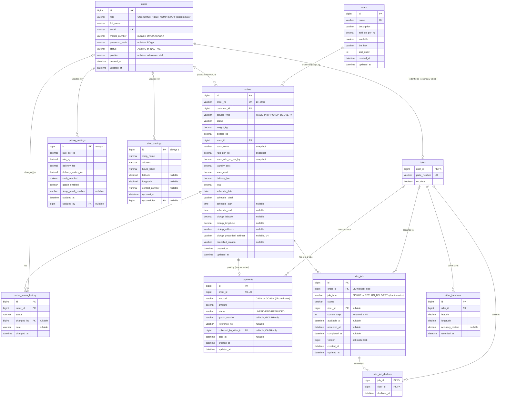
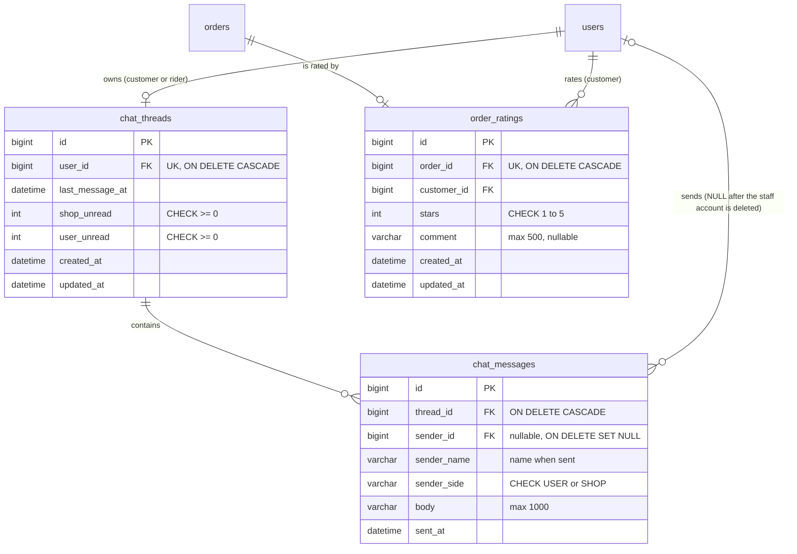

# Laundry HUB database (ERD)

PostgreSQL schema `laundryhub` on Supabase, owned by **Flyway**. Hibernate only validates it (`spring.jpa.hibernate.ddl-auto: validate`).
The diagram is built from the migrations in `backend/src/main/resources/db/migration/`:

| Migration | Content |
|---|---|
| `V1__init.sql` | all 11 tables, keys, CHECK constraints and indexes |
| `V2__reference_data.sql` | reference rows: the 4 soaps, `pricing_settings` row 1 (₱30/kg, 8 kg, ₱60, 5 km), `shop_settings` row 1 |
| `V3__sample_orders.sql` | **sample data only**, in `db/sample-data/` (customers, riders, orders, payments, jobs shown in the A1/A2 design). It does not change the schema. Skip it with `FLYWAY_LOCATIONS=classpath:db/migration`. |
| `V4__dispatch_and_geocoding.sql` | renames `rider_jobs.steps_completed` to `current_step` (and re-creates its CHECK); adds `orders.pickup_geocoded_address` |

The first admin account is not inserted by a migration. `AdminAccountSeeder` creates it at
startup from `ADMIN_DEFAULT_EMAIL` / `ADMIN_DEFAULT_PASSWORD`.

Conventions: money is `DECIMAL(10,2)`, kilos `DECIMAL(6,2)`, coordinates `DECIMAL(9,6)`, timestamps
`DATETIME(6)` in shop local time, and enums are stored as `VARCHAR` names.

## Diagram

The diagram shows the schema after V4. Types are simplified for Mermaid (`varchar` stands for
`VARCHAR(n)`, `decimal` for `DECIMAL(p,s)`). Exact sizes are in the tables below.

Cardinality notes:

- An order has **at most one** payment (`payments.order_id` is UNIQUE). The application always
  creates it when the order is placed.
- An order has **0 or 2** rider jobs: none for walk-in, and one `PICKUP` plus one `RETURN_DELIVERY`
  for Pickup & Delivery. `UNIQUE (order_id, job_type)` guarantees at most one of each type.
- `pricing_settings` and `shop_settings` are single-row tables (`CHECK (id = 1)`).

## Entities

### `users` → `User` (abstract), `Customer`, `Rider`, `ConsoleUser` (abstract), `Admin`, `Staff`

| | |
|---|---|
| Purpose | Every account, for all four roles. |
| Keys and constraints | `uk_users_email` UNIQUE (email); CHECK role in (CUSTOMER, RIDER, ADMIN, STAFF); CHECK status in (ACTIVE, INACTIVE); CHECK mobile_number is NULL or `^09[0-9]{9}$`. Indexes on `role` and `mobile_number`. |
| Sizes | full_name 120, email 190, mobile_number 11, password_hash 100, status 20, position 60 |
| JPA mapping | **Single-table inheritance**: `@Inheritance(SINGLE_TABLE)` on `User`, `@DiscriminatorColumn(name = "role")`. `Customer`, `Rider`, `Admin`, `Staff` each have a `@DiscriminatorValue`. `ConsoleUser` is the abstract parent of `Admin` and `Staff` and maps `position`. `User` extends the `@MappedSuperclass` `AuditedEntity` (`id`, `created_at`, `updated_at`). Deleting an account is a soft delete (`status = INACTIVE`). |

### `riders` → fields of `Rider`

| | |
|---|---|
| Purpose | Rider-only fields: vehicle plate and the On duty / Off duty switch. |
| Keys and constraints | PK `user_id`, also FK to `users(id)` ON DELETE CASCADE; `uk_riders_plate` UNIQUE (plate_number); index on `on_duty`. |
| JPA mapping | Not a separate entity. `Rider` declares `@SecondaryTable(name = "riders", pkJoinColumns = @PrimaryKeyJoinColumn(name = "user_id"))`, and its `plateNumber` and `onDuty` fields use `@Column(table = "riders")`. One `Rider` object is spread over a `users` row and a `riders` row (1 : 0..1). |

### `soaps` → `Soap`

| | |
|---|---|
| Purpose | Fabric soaps on screen 03, edited on A3. |
| Keys and constraints | `uk_soaps_name` UNIQUE (name); CHECK add_on_per_kg ≥ 0; CHECK tint_hex matches `^#[0-9A-Fa-f]{6}$`. |
| JPA mapping | `@Entity Soap extends AuditedEntity`. A soap used by any order cannot be deleted (FK from `orders`); the API answers 409 and the admin unticks `available` instead. |

### `pricing_settings` → `PricingSettings`

| | |
|---|---|
| Purpose | Rate per kg, minimum kg, delivery fee, delivery radius, payment methods, shop GCash number (A3). |
| Keys and constraints | Single row: CHECK id = 1. CHECK rate_per_kg > 0, min_kg > 0, delivery_fee ≥ 0, delivery_radius_km > 0, shop_gcash_number NULL or `^09[0-9]{9}$`. FK `updated_by` → `users(id)` ON DELETE SET NULL. |
| JPA mapping | `@Entity`, not audited (has its own `updated_at`); `@ManyToOne User updatedBy`. |

### `shop_settings` → `ShopSettings`

| | |
|---|---|
| Purpose | Shop card on 04b, shop marker on 07, and the centre of the delivery radius (unless `SHOP_LAT`/`SHOP_LNG` are set). |
| Keys and constraints | Single row: CHECK id = 1. CHECK latitude and longitude are both NULL or both set. FK `updated_by` → `users(id)` ON DELETE SET NULL. |
| JPA mapping | `@Entity`; `@ManyToOne User updatedBy`. |

### `orders` → `Order` (entity name `LaundryOrder`)

| | |
|---|---|
| Purpose | One laundry order with a **price snapshot**, taken by the server when the order is placed. Later price changes do not affect it. |
| Keys and constraints | `uk_orders_order_no` UNIQUE (order_no); FK `customer_id` → `users`; FK `soap_id` → `soaps`. CHECKs: service_type in (WALK_IN, PICKUP_DELIVERY); status in the 6 order statuses; weight_kg > 0 and billable_kg ≥ weight_kg; costs ≥ 0 and **total = laundry_cost + soap_cost + delivery_fee**; a PICKUP_DELIVERY order must have a pin; schedule_start/end both NULL or both set with start < end. Indexes on `status`, `(customer_id, created_at)`, `created_at`. |
| JPA mapping | `@Entity(name = "LaundryOrder")` (because `Order` is an SQL keyword) `@Table(name = "orders")`, extends `AuditedEntity`. `@ManyToOne Customer`, `@ManyToOne Soap`. Two `@Embeddable` value objects: `TimeSlot` (schedule_date, schedule_label, schedule_start, schedule_end) and `Location` (re-mapped with `@AttributeOverrides` to pickup_latitude, pickup_longitude, pickup_address). `@OneToOne(mappedBy = "order") PaymentMethod payment` and `@OneToMany(mappedBy = "order") history`. `service_type` is stored as the `ServiceCode` enum and turned into the polymorphic `ServiceType` (`WalkInService` / `PickupDeliveryService`) in code. |

### `order_status_history` → `OrderStatusHistory`

| | |
|---|---|
| Purpose | Every status change: the 07 timeline times and the A2 audit trail. |
| Keys and constraints | FK `order_id` → `orders` ON DELETE CASCADE; FK `changed_by` → `users` ON DELETE SET NULL (NULL = system); CHECK status in the 6 order statuses. Index `(order_id, changed_at)`. |
| JPA mapping | `@Entity` with `@ManyToOne Order` and `@ManyToOne User changedBy`. |

### `payments` → `PaymentMethod` (abstract), `CashPayment`, `GCashPayment`

| | |
|---|---|
| Purpose | The single payment of an order and whether it is paid. |
| Keys and constraints | `uk_payments_order` UNIQUE (order_id), FK → `orders` ON DELETE CASCADE; FK `collected_by_rider_id` → `riders(user_id)` ON DELETE SET NULL. CHECKs: method in (CASH, GCASH); status in (UNPAID, PAID, REFUNDED); amount ≥ 0; GCASH needs a valid gcash_number; **paid_at is NULL exactly when status is UNPAID**. Indexes on `status`, `method`. |
| JPA mapping | **Single-table inheritance**: `@Inheritance(SINGLE_TABLE)`, `@DiscriminatorColumn(name = "method")`. `CashPayment` (`@DiscriminatorValue("CASH")`) maps `collected_by_rider_id` as `@ManyToOne Rider collectedBy`; `GCashPayment` (`@DiscriminatorValue("GCASH")`) maps `gcash_number`. `PaymentMethod` implements the `Payable` interface and owns the `@OneToOne` to `Order`. |

### `rider_jobs` → `RiderJob` (abstract), `PickupJob`, `DeliveryJob`

| | |
|---|---|
| Purpose | Rider bookings: a `PICKUP` job (customer → shop) and a `RETURN_DELIVERY` job (shop → customer) per Pickup & Delivery order. |
| Keys and constraints | `uk_jobs_order_type` UNIQUE (order_id, job_type); FK `order_id` → `orders` ON DELETE CASCADE; FK `rider_id` → `riders(user_id)` ON DELETE SET NULL. CHECKs: job_type in (PICKUP, RETURN_DELIVERY); status in (WAITING, AVAILABLE, ACCEPTED, IN_PROGRESS, COMPLETED, CANCELLED); current_step ≥ 0 (`ck_jobs_current_step`, V4). Indexes `(status, job_type)`, `(rider_id, status)`. |
| Optimistic locking | `version BIGINT` mapped with `@Version`. When two riders accept the same job, the second update fails and the API returns 409 ("already taken by another rider"). |
| JPA mapping | **Single-table inheritance**: `@Inheritance(SINGLE_TABLE)`, `@DiscriminatorColumn(name = "job_type")`. `PickupJob` has `@DiscriminatorValue("PICKUP")` and `DeliveryJob` has `@DiscriminatorValue("RETURN_DELIVERY")`. Each subclass overrides its step list and start point (polymorphism). Extends `AuditedEntity`. |

### `rider_job_declines` → `RiderJobDecline`

| | |
|---|---|
| Purpose | "Decline" hides a job from that rider only. |
| Keys and constraints | Composite PK `(job_id, rider_id)`, so a rider declines a job at most once. FK `job_id` → `rider_jobs` ON DELETE CASCADE; FK `rider_id` → `riders(user_id)` ON DELETE CASCADE. Index on `rider_id`. |
| JPA mapping | `@EmbeddedId` (an `@Embeddable` key class with `jobId`, `riderId`) and two `@ManyToOne` associations with `@MapsId`. |

### `rider_locations` → `RiderLocation`

| | |
|---|---|
| Purpose | GPS fixes from the rider app: distance sorting on R1 and the live map on 07. |
| Keys and constraints | FK `rider_id` → `riders(user_id)` ON DELETE CASCADE; CHECK latitude between −90 and 90 and longitude between −180 and 180. Index `(rider_id, recorded_at)`. |
| JPA mapping | `@Entity` with `@ManyToOne Rider`. |

## Inheritance summary

| Class hierarchy | Strategy | Table | Discriminator column |
|---|---|---|---|
| `User` → `Customer`, `Rider`, `ConsoleUser` → `Admin`, `Staff` | SINGLE_TABLE (+ secondary table `riders` for `Rider`) | `users` | `role` |
| `PaymentMethod` → `CashPayment`, `GCashPayment` | SINGLE_TABLE | `payments` | `method` |
| `RiderJob` → `PickupJob`, `DeliveryJob` | SINGLE_TABLE | `rider_jobs` | `job_type` |
| `AuditedEntity` (`@MappedSuperclass`) → `User`, `Soap`, `Order`, `PaymentMethod`, `RiderJob` | columns copied into each table | — | — |

## Feedback chat and ratings (V5)

`V5__feedback_chat.sql` adds three tables. The feature has no design yet (CLAUDE.md §7).

| Table | Entity | Notes |
|---|---|---|
| `chat_threads` | `ChatThread` (`AuditedEntity`) | One conversation per customer or rider (`uk_chat_threads_user`). Admin/staff never own one: `User.chatSide()` is `USER` for customers and riders and `SHOP` for `ConsoleUser`. Unread counters per side. |
| `chat_messages` | `ChatMessage` | Immutable. `sender_side` (`MessageSide`) is decided by the sender's account type. `sender_name` keeps the name if the account is later deleted. Index `(thread_id, id)` serves polling with `after=<last id>`. |
| `order_ratings` | `OrderRating` (`AuditedEntity`) | One per order (`uk_order_ratings_order`), only for the customer's own **completed** order; 1–5 stars (`ck_order_ratings_stars`); can be changed. |
