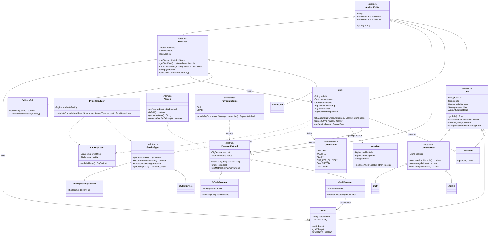
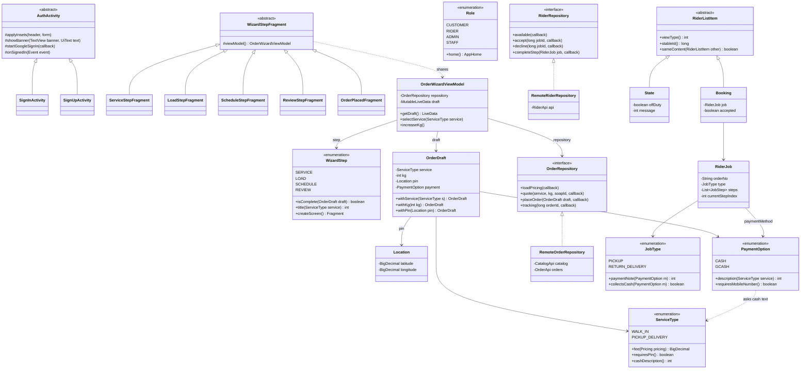
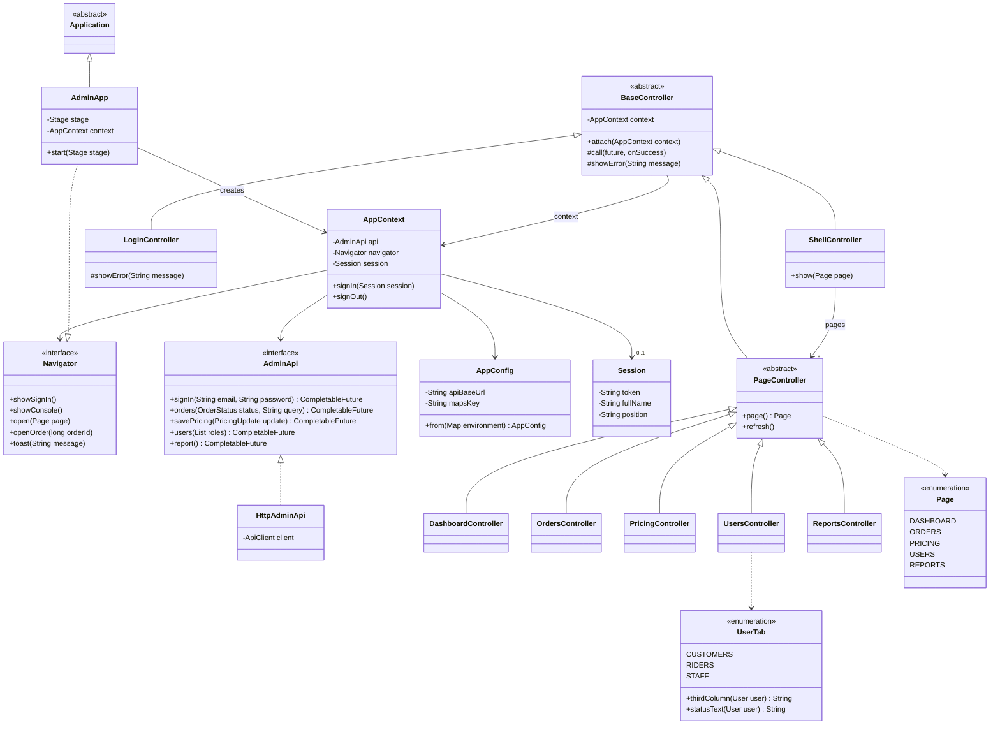

# Laundry HUB: Object-Oriented Design

This document is for grading. It maps the four OOP pillars to **specific classes and line
numbers** in the three projects:

| Project | Source root | What it is |
|---|---|---|
| **Backend** | `backend/src/main/java/com/laundryhub/backend/` | Spring Boot REST API. It holds all business rules: pricing, order status, rider jobs, payments. |
| **Android** | `android-app/app/src/main/java/com/laundryhub/app/` | Customer app and Rider app (one APK, routed by role) |
| **Admin** | `admin-desktop/src/main/java/com/laundryhub/admin/` | JavaFX admin / staff console |

Every pillar is marked in the code with a comment on the line above it, in exactly this form
(CLAUDE.md §5):

```java
// OOP: Encapsulation — ...
// OOP: Inheritance — ...
// OOP: Polymorphism — ...
// OOP: Abstraction — ...
```

**How to read the tables.** The *Line* column links to the `// OOP:` marker; the code it
describes starts on the next line. Rows marked *(no marker)* point straight at the code. To list
every marker yourself, run `git grep -n "// OOP:"` from the repo root.

**Marker count** (production code only, tests excluded):

| Pillar | Backend | Android | Admin | Total |
|---|---:|---:|---:|---:|
| Encapsulation | 18 | 67 | 16 | 101 |
| Inheritance | 25 | 42 | 11 | 78 |
| Polymorphism | 40 | 33 | 11 | 84 |
| Abstraction | 23 | 17 | 4 | 44 |
| **Total** | **106** | **159** | **42** | **307** |

---

## 1. Encapsulation

Every field in all three projects is `private`, and most are also `final`. Objects that must stay valid check their
arguments **once, in the constructor**, and then never change (`Location`, `LaundryLoad`,
`OrderDraft`, `Session`, `AppConfig`). Objects that do change, such as an order, a rider job or a
payment, offer **behaviour instead of setters**: you cannot set `status` directly. You call `accept()`,
`completeCurrentStep()` or `markRefunded()`, and the method enforces the rule first. On Android, ViewModels keep
`MutableLiveData` private and expose only read-only `LiveData`.

| Project | Class | Line | What it shows |
|---|---|---|---|
| Backend | `Location` | [Location.java:14](../backend/src/main/java/com/laundryhub/backend/domain/common/Location.java#L14) | Immutable value object. The constructor rejects a missing or out-of-range latitude/longitude (±90 / ±180), and callers use the behaviour `distanceKmTo()` rather than the raw numbers. |
| Backend | `LaundryLoad` | [LaundryLoad.java:12](../backend/src/main/java/com/laundryhub/backend/domain/order/LaundryLoad.java#L12) | `private final` weight. The constructor rejects ≤ 0 kg and anything under the 8 kg minimum. `getBillableKg()` is **derived** (`max(weight, min)`) and can never be set. |
| Backend | `Money` | [Money.java:7](../backend/src/main/java/com/laundryhub/backend/domain/common/Money.java#L7) *(no marker)* | Private constructor and one `of()` method, so every peso amount is rounded the same way (`SCALE = 2`, `HALF_UP`). |
| Backend | `Order` | [Order.java:52](../backend/src/main/java/com/laundryhub/backend/domain/order/Order.java#L52) | All fields private. The status changes only through `changeStatus()`/`cancel()`, which also write the status history. The constructor validates the order number and requires a pin for Pickup & Delivery. |
| Backend | `RiderJob` | [RiderJob.java:42](../backend/src/main/java/com/laundryhub/backend/domain/rider/RiderJob.java#L42) | `status`, `rider` and `currentStep` change only through `accept()`, `assignTo()` and `completeCurrentStep()`. These check that the rider is on duty and that the job is assigned to the caller. A `@Version` field guards against double-accept. |
| Backend | `PaymentMethod` | [PaymentMethod.java:42](../backend/src/main/java/com/laundryhub/backend/domain/payment/PaymentMethod.java#L42) | `markPaid()` is `protected` (only subclasses may call it). `changeAmount()` refuses once paid, and `markRefunded()` works only on a paid payment. |
| Backend | `User` | [User.java:40](../backend/src/main/java/com/laundryhub/backend/domain/user/User.java#L40) | `rename()`, `changeMobileNumber()` and `changePasswordHash()` validate their input; a password is accepted only as a 60-character BCrypt hash. |
| Backend | `GoogleGeocodingService` | [GoogleGeocodingService.java:32](../backend/src/main/java/com/laundryhub/backend/service/geo/GoogleGeocodingService.java#L32) | The Google API key stays inside the class and is never logged. |
| Android | `Location` | [Location.java:21](../android-app/app/src/main/java/com/laundryhub/app/model/Location.java#L21) | `private final` coordinates, validated in the constructor (`IllegalArgumentException` when out of range). |
| Android | `OrderDraft` | [OrderDraft.java:24](../android-app/app/src/main/java/com/laundryhub/app/model/OrderDraft.java#L24) | Immutable wizard state with a private constructor. Each change returns a **new copy** through `withService()`, `withKg()`, `withPin()` and the other `with...()` methods. |
| Android | `RiderJob` (model) | [RiderJob.java:34](../android-app/app/src/main/java/com/laundryhub/app/model/rider/RiderJob.java#L34) | `private final` fields. The constructor rejects incomplete jobs and an out-of-range step index, and copies the step list defensively (`List.copyOf`). |
| Android | `OrderWizardViewModel` | [OrderWizardViewModel.java:46](../android-app/app/src/main/java/com/laundryhub/app/ui/order/OrderWizardViewModel.java#L46) | `MutableLiveData` fields are private. Screens get read-only `LiveData` and call actions (`selectService()`, `increaseKg()`). |
| Admin | `AppConfig` | [AppConfig.java:20](../admin-desktop/src/main/java/com/laundryhub/admin/AppConfig.java#L20) | Immutable settings. The constructor rejects an API URL that is blank or doesn't end in `/`. |
| Admin | `Session` | [Session.java:12](../admin-desktop/src/main/java/com/laundryhub/admin/model/Session.java#L12) | Set once at sign-in. The constructor rejects a blank token or name. |
| Admin | `AppContext` / `BaseController` | [AppContext.java:17](../admin-desktop/src/main/java/com/laundryhub/admin/ui/AppContext.java#L17), [BaseController.java:22](../admin-desktop/src/main/java/com/laundryhub/admin/ui/BaseController.java#L22) | The session changes only through `signIn()`/`signOut()`. The controller's context is set once by the `final attach()`, which rejects `null`. |
| Backend | `ChatThread` | [ChatThread.java:25](../backend/src/main/java/com/laundryhub/backend/domain/feedback/ChatThread.java#L25) | Owner fixed at creation; unread counters change only through `post()` and `markReadBy()`; messages are immutable. |

---

## 2. Inheritance

The domain uses class hierarchies wherever several kinds of a thing share data and rules. In the backend,
users, rider jobs and payments are JPA `SINGLE_TABLE` hierarchies: shared fields and the workflow live in
the abstract base class, and each subclass adds only what makes it different. All entities share id
and timestamps through `AuditedEntity`. The two clients use inheritance to share screen
behaviour: a base activity for sign in / sign up, a base fragment for the wizard steps, and on the admin side
`BaseController → PageController → each page`.

| Project | Class | Line | What it shows |
|---|---|---|---|
| Backend | `AuditedEntity` | [AuditedEntity.java:16](../backend/src/main/java/com/laundryhub/backend/domain/common/AuditedEntity.java#L16) | `@MappedSuperclass` holding `id`, `createdAt` and `updatedAt`. It is extended by `User`, `Order`, `RiderJob`, `PaymentMethod` and other entities. |
| Backend | `User` (abstract) | [User.java:24](../backend/src/main/java/com/laundryhub/backend/domain/user/User.java#L24) | Base of all accounts: name, e-mail, mobile, password hash, status. |
| Backend | `Customer`, `Rider` | [Customer.java:7](../backend/src/main/java/com/laundryhub/backend/domain/user/Customer.java#L7), [Rider.java:15](../backend/src/main/java/com/laundryhub/backend/domain/user/Rider.java#L15) | Direct subclasses of `User`. `Rider` adds `plateNumber` and the on-duty switch. |
| Backend | `ConsoleUser` → `Admin`, `Staff` | [ConsoleUser.java:13](../backend/src/main/java/com/laundryhub/backend/domain/user/ConsoleUser.java#L13), [Admin.java:7](../backend/src/main/java/com/laundryhub/backend/domain/user/Admin.java#L7), [Staff.java:7](../backend/src/main/java/com/laundryhub/backend/domain/user/Staff.java#L7) | **Multi-level** hierarchy `User → ConsoleUser → Admin / Staff`. `ConsoleUser` adds `position` and console access. |
| Backend | `RiderJob` → `PickupJob`, `DeliveryJob` | [RiderJob.java:35](../backend/src/main/java/com/laundryhub/backend/domain/rider/RiderJob.java#L35), [PickupJob.java:13](../backend/src/main/java/com/laundryhub/backend/domain/rider/PickupJob.java#L13), [DeliveryJob.java:19](../backend/src/main/java/com/laundryhub/backend/domain/rider/DeliveryJob.java#L19) | Shared accept/decline/step workflow in the base class. `DeliveryJob` is the return-delivery job (`RETURN_DELIVERY`). |
| Backend | `PaymentMethod` → `CashPayment`, `GCashPayment` | [PaymentMethod.java:32](../backend/src/main/java/com/laundryhub/backend/domain/payment/PaymentMethod.java#L32), [CashPayment.java:16](../backend/src/main/java/com/laundryhub/backend/domain/payment/CashPayment.java#L16), [GCashPayment.java:11](../backend/src/main/java/com/laundryhub/backend/domain/payment/GCashPayment.java#L11) | Amount and status are shared. Cash adds `collectedBy` and GCash adds `gcashNumber`. |
| Backend | `ServiceType` → `WalkInService`, `PickupDeliveryService` | [WalkInService.java:9](../backend/src/main/java/com/laundryhub/backend/domain/order/WalkInService.java#L9), [PickupDeliveryService.java:14](../backend/src/main/java/com/laundryhub/backend/domain/order/PickupDeliveryService.java#L14) | Two `final` concrete services under the abstract `ServiceType`. |
| Backend | `ApiException` → `NotFoundException`, ... | [ApiException.java:10](../backend/src/main/java/com/laundryhub/backend/exception/ApiException.java#L10), [NotFoundException.java:6](../backend/src/main/java/com/laundryhub/backend/exception/NotFoundException.java#L6) | Five HTTP error types (404, 409, 403, 401, 503) under one abstract base. |
| Android | `AuthActivity` → `SignInActivity`, `SignUpActivity` | [AuthActivity.java:28](../android-app/app/src/main/java/com/laundryhub/app/ui/auth/AuthActivity.java#L28), [SignInActivity.java:19](../android-app/app/src/main/java/com/laundryhub/app/ui/auth/SignInActivity.java#L19), [SignUpActivity.java:23](../android-app/app/src/main/java/com/laundryhub/app/ui/auth/SignUpActivity.java#L23) | The base class handles the blue header, insets, error banner, Google sign-in and the redirect after sign-in. |
| Android | `WizardStepFragment` → 5 step fragments | [WizardStepFragment.java:9](../android-app/app/src/main/java/com/laundryhub/app/ui/order/WizardStepFragment.java#L9), [ServiceStepFragment.java:17](../android-app/app/src/main/java/com/laundryhub/app/ui/order/ServiceStepFragment.java#L17), [LoadStepFragment.java:28](../android-app/app/src/main/java/com/laundryhub/app/ui/order/LoadStepFragment.java#L28), [ScheduleStepFragment.java:50](../android-app/app/src/main/java/com/laundryhub/app/ui/order/ScheduleStepFragment.java#L50), [ReviewStepFragment.java:26](../android-app/app/src/main/java/com/laundryhub/app/ui/order/ReviewStepFragment.java#L26), [OrderPlacedFragment.java:17](../android-app/app/src/main/java/com/laundryhub/app/ui/order/OrderPlacedFragment.java#L17) | Every step inherits `viewModel()`, which returns the one shared wizard ViewModel. |
| Android | `RiderListItem` → `State`, `Booking` | [RiderListItem.java:34](../android-app/app/src/main/java/com/laundryhub/app/ui/rider/RiderListItem.java#L34), [RiderListItem.java:96](../android-app/app/src/main/java/com/laundryhub/app/ui/rider/RiderListItem.java#L96) | Two row kinds of the rider bookings list (an off-duty or empty card, and a booking card). |
| Android | Custom widgets | [FormField.java:25](../android-app/app/src/main/java/com/laundryhub/app/ui/widget/FormField.java#L25), [SegmentedControl.java:26](../android-app/app/src/main/java/com/laundryhub/app/ui/widget/SegmentedControl.java#L26), [DutySwitch.java:26](../android-app/app/src/main/java/com/laundryhub/app/ui/widget/DutySwitch.java#L26), [MapFrame.java:23](../android-app/app/src/main/java/com/laundryhub/app/ui/widget/MapFrame.java#L23), [StepChecklist.java:23](../android-app/app/src/main/java/com/laundryhub/app/ui/widget/StepChecklist.java#L23) | Design-system components that extend Android `LinearLayout` / `FrameLayout`. |
| Admin | `BaseController` → `PageController` → pages | [BaseController.java:17](../admin-desktop/src/main/java/com/laundryhub/admin/ui/BaseController.java#L17), [PageController.java:5](../admin-desktop/src/main/java/com/laundryhub/admin/ui/PageController.java#L5), [DashboardController.java:21](../admin-desktop/src/main/java/com/laundryhub/admin/ui/DashboardController.java#L21), [OrdersController.java:37](../admin-desktop/src/main/java/com/laundryhub/admin/ui/OrdersController.java#L37), [PricingController.java:27](../admin-desktop/src/main/java/com/laundryhub/admin/ui/PricingController.java#L27), [UsersController.java:17](../admin-desktop/src/main/java/com/laundryhub/admin/ui/UsersController.java#L17), [ReportsController.java:28](../admin-desktop/src/main/java/com/laundryhub/admin/ui/ReportsController.java#L28) | Three levels. All controllers inherit `call()` (async API call with error handling), and pages also inherit the `refresh()` contract. |
| Admin | `LoginController`, `ShellController` | [LoginController.java:19](../admin-desktop/src/main/java/com/laundryhub/admin/ui/LoginController.java#L19), [ShellController.java:32](../admin-desktop/src/main/java/com/laundryhub/admin/ui/ShellController.java#L32) | Non-page screens that extend `BaseController` directly. |
| Admin | `AdminApp` | [AdminApp.java:23](../admin-desktop/src/main/java/com/laundryhub/admin/AdminApp.java#L23) | `extends javafx.application.Application` and `implements Navigator`. |

Other framework subclasses: all ViewModels extend `ViewModel` (e.g. [OrderWizardViewModel.java:40](../android-app/app/src/main/java/com/laundryhub/app/ui/order/OrderWizardViewModel.java#L40)),
`LaundryHubApp extends Application` ([LaundryHubApp.java:12](../android-app/app/src/main/java/com/laundryhub/app/LaundryHubApp.java#L12)), and `RiderLocationService extends Service`
([RiderLocationService.java:44](../android-app/app/src/main/java/com/laundryhub/app/ui/rider/RiderLocationService.java#L44)).

---

## 3. Polymorphism

Callers hold a **base type** (`RiderJob`, `ServiceType`, `PaymentMethod`, `User`, `PageController`)
and call a method that each subclass overrides, so no `if (type == ...)` is needed. The clients also use
**enums with constant-specific bodies** (each constant overrides an abstract method), for example
`Role.home()`, `JobType.paymentNote()`, `UserTab.thirdColumn()`. `RiderJob.completeCurrentStep()` is a
*template method*: the base class runs the workflow and asks the subclass for `getSteps()` and
`orderStatusAfter()`.

| Project | Overridden method | Line | Subclass answers → called through the base type at |
|---|---|---|---|
| Backend | `RiderJob.getSteps()` / `orderStatusAfter()` | [RiderJob.java:110](../backend/src/main/java/com/laundryhub/backend/domain/rider/RiderJob.java#L110), [RiderJob.java:132](../backend/src/main/java/com/laundryhub/backend/domain/rider/RiderJob.java#L132) | `PickupJob` has 4 fixed steps ([PickupJob.java:44](../backend/src/main/java/com/laundryhub/backend/domain/rider/PickupJob.java#L44)). `DeliveryJob` has 5 steps with cash or 4 prepaid ([DeliveryJob.java:59](../backend/src/main/java/com/laundryhub/backend/domain/rider/DeliveryJob.java#L59)). Both are used inside the template method `completeCurrentStep()` (RiderJob.java lines 231–241). |
| Backend | `RiderJob.getStartPoint()` | [RiderJob.java:123](../backend/src/main/java/com/laundryhub/backend/domain/rider/RiderJob.java#L123) | Pickup starts at the customer and delivery at the shop. Called in [RiderJobService.java:247](../backend/src/main/java/com/laundryhub/backend/service/RiderJobService.java#L247). |
| Backend | `ServiceType.getServiceFee()` | [ServiceType.java:48](../backend/src/main/java/com/laundryhub/backend/domain/order/ServiceType.java#L48) | Walk-in ₱0 ([WalkInService.java:30](../backend/src/main/java/com/laundryhub/backend/domain/order/WalkInService.java#L30)), delivery fee ([PickupDeliveryService.java:49](../backend/src/main/java/com/laundryhub/backend/domain/order/PickupDeliveryService.java#L49)). Called in [PriceCalculator.java:62](../backend/src/main/java/com/laundryhub/backend/domain/pricing/PriceCalculator.java#L62). |
| Backend | `ServiceType.getSlotOptions()` | [ServiceType.java:58](../backend/src/main/java/com/laundryhub/backend/domain/order/ServiceType.java#L58) | Pickup windows vs. drop-off parts of the day. Called in [CatalogService.java:81](../backend/src/main/java/com/laundryhub/backend/service/CatalogService.java#L81). |
| Backend | `Payable.getInstructions()` / `getDisplayName()` | [CashPayment.java:79](../backend/src/main/java/com/laundryhub/backend/domain/payment/CashPayment.java#L79), [GCashPayment.java:68](../backend/src/main/java/com/laundryhub/backend/domain/payment/GCashPayment.java#L68) | Cash: "Pay the rider upon delivery" or "Pay at the counter". GCash: "Pay instantly from your e-wallet". Called in [PaymentResponse.java:32](../backend/src/main/java/com/laundryhub/backend/web/dto/PaymentResponse.java#L32). |
| Backend | `PaymentMethod.confirmFromConsole()` | [AdminOrderService.java:184](../backend/src/main/java/com/laundryhub/backend/service/AdminOrderService.java#L184), [PaymentMethod.java:124](../backend/src/main/java/com/laundryhub/backend/domain/payment/PaymentMethod.java#L124) | A2 "mark paid" calls the abstract method on whatever `PaymentMethod` the order has: `CashPayment` records cash at the counter (receipt optional), `GCashPayment` requires the GCash reference. No `instanceof`. |
| Backend | `PaymentChoice.attachTo()` (enum constant bodies) | [PaymentChoice.java:52](../backend/src/main/java/com/laundryhub/backend/domain/payment/PaymentChoice.java#L52) | `CASH` builds a `CashPayment`, `GCASH` a `GCashPayment`. Called in [OrderService.java:134](../backend/src/main/java/com/laundryhub/backend/service/OrderService.java#L134). |
| Backend | `User.getRole()` / `canUseAdminConsole()`, `ConsoleUser.canManageAccounts()` | [User.java:77](../backend/src/main/java/com/laundryhub/backend/domain/user/User.java#L77), [User.java:90](../backend/src/main/java/com/laundryhub/backend/domain/user/User.java#L90), [ConsoleUser.java:55](../backend/src/main/java/com/laundryhub/backend/domain/user/ConsoleUser.java#L55) | Only console users answer `true` for console access, and only `Admin` may manage accounts. Called in [AuthService.java:114](../backend/src/main/java/com/laundryhub/backend/service/AuthService.java#L114) and [AdminUserService.java:191](../backend/src/main/java/com/laundryhub/backend/service/AdminUserService.java#L191). |
| Backend | `ApiException.getStatus()` | [ApiException.java:25](../backend/src/main/java/com/laundryhub/backend/exception/ApiException.java#L25) | Each subclass returns its own HTTP status. One handler serves them all: [GlobalExceptionHandler.java:50](../backend/src/main/java/com/laundryhub/backend/web/GlobalExceptionHandler.java#L50). |
| Android | `JobType.paymentNote()` / `collectsCash()` | [JobType.java:70](../android-app/app/src/main/java/com/laundryhub/app/model/rider/JobType.java#L70) | Pickup and return delivery word the payment differently. Called in [ActiveJobActivity.java:193](../android-app/app/src/main/java/com/laundryhub/app/ui/rider/ActiveJobActivity.java#L193). |
| Android | `ServiceType.fee()` | [ServiceType.java:106](../android-app/app/src/main/java/com/laundryhub/app/model/ServiceType.java#L106) | Walk-in adds ₱0 and delivery adds the fee. The live estimate is computed in [Pricing.java:67](../android-app/app/src/main/java/com/laundryhub/app/model/Pricing.java#L67). |
| Android | `PaymentOption.description()` | [PaymentOption.java:61](../android-app/app/src/main/java/com/laundryhub/app/model/PaymentOption.java#L61) | Cash delegates to `ServiceType.cashDescription()` (double dispatch, [PaymentOption.java:17](../android-app/app/src/main/java/com/laundryhub/app/model/PaymentOption.java#L17)). |
| Android | `Role.home()` | [Role.java:45](../android-app/app/src/main/java/com/laundryhub/app/model/Role.java#L45) | Each role constant names its home screen. Called in [HomeNavigator.java:28](../android-app/app/src/main/java/com/laundryhub/app/ui/HomeNavigator.java#L28). |
| Android | `WizardStep.isComplete()` / `title()` | [WizardStep.java:105](../android-app/app/src/main/java/com/laundryhub/app/ui/order/WizardStep.java#L105) | Each step has its own "Continue enabled" rule. Called in [OrderWizardViewModel.java:463](../android-app/app/src/main/java/com/laundryhub/app/ui/order/OrderWizardViewModel.java#L463) and [OrderWizardActivity.java:122](../android-app/app/src/main/java/com/laundryhub/app/ui/order/OrderWizardActivity.java#L122). |
| Admin | `PageController.refresh()` | [PageController.java:12](../admin-desktop/src/main/java/com/laundryhub/admin/ui/PageController.java#L12) | The shell calls `controller.refresh()` on whichever page is open (ShellController.java line 122). Overrides: [DashboardController.java:55](../admin-desktop/src/main/java/com/laundryhub/admin/ui/DashboardController.java#L55), [OrdersController.java:159](../admin-desktop/src/main/java/com/laundryhub/admin/ui/OrdersController.java#L159), [PricingController.java:71](../admin-desktop/src/main/java/com/laundryhub/admin/ui/PricingController.java#L71), [UsersController.java:57](../admin-desktop/src/main/java/com/laundryhub/admin/ui/UsersController.java#L57), [ReportsController.java:58](../admin-desktop/src/main/java/com/laundryhub/admin/ui/ReportsController.java#L58). |
| Admin | `UserTab.thirdColumn()` / `BaseController.showError()` | [UserTab.java:71](../admin-desktop/src/main/java/com/laundryhub/admin/ui/UserTab.java#L71), [BaseController.java:100](../admin-desktop/src/main/java/com/laundryhub/admin/ui/BaseController.java#L100) | Customers / Riders / Staff tabs fill the third column differently. `showError()` shows a toast by default, and `LoginController` overrides it to use its banner ([LoginController.java:114](../admin-desktop/src/main/java/com/laundryhub/admin/ui/LoginController.java#L114)). |
| Backend | `User.chatSide()` / `ConsoleUser.chatSide()` | [User.java:85](../backend/src/main/java/com/laundryhub/backend/domain/user/User.java#L85), [ChatThread.java:64](../backend/src/main/java/com/laundryhub/backend/domain/feedback/ChatThread.java#L64) | Feedback chat: the account type decides the side of a message. Customers and riders write as `USER`, admin and staff (any `ConsoleUser`) answer as `SHOP`. `ChatThread.post()` calls it through the `User` base type, without role checks. |

---

## 4. Abstraction

Code depends on **what** something does, not **how** it does it. In the backend, services depend on
repository interfaces (Spring Data writes the implementation) and on small interfaces for external
systems (`TokenService`, `GeocodingService`, `GoogleTokenVerifier`). Tests swap in fakes for these.
On Android, ViewModels see only `OrderRepository` / `RiderRepository` / `AuthRepository`, never
Retrofit. The admin controllers see only `AdminApi` and `Navigator`, never HTTP or JavaFX stages.
Abstract classes (`RiderJob`, `PaymentMethod`, `ServiceType`, `User`, `BaseController`) hide shared
logic behind a small set of abstract methods.

| Project | Abstraction | Line | Hidden detail / implemented by |
|---|---|---|---|
| Backend | 13 repository interfaces (e.g. `OrderRepository`, `RiderJobRepository`) | [OrderRepository.java:16](../backend/src/main/java/com/laundryhub/backend/repository/OrderRepository.java#L16), [RiderJobRepository.java:17](../backend/src/main/java/com/laundryhub/backend/repository/RiderJobRepository.java#L17) | SQL and JPA. Spring Data generates the implementation. |
| Backend | `Payable` (interface) | [Payable.java:6](../backend/src/main/java/com/laundryhub/backend/domain/payment/Payable.java#L6) | `amountDue`, `isPaid`, `instructions`, `collectsCashOnDelivery`. Implemented by `PaymentMethod`. |
| Backend | `PaymentMethod`, `RiderJob`, `ServiceType` (abstract classes) | [PaymentMethod.java:31](../backend/src/main/java/com/laundryhub/backend/domain/payment/PaymentMethod.java#L31), [RiderJob.java:34](../backend/src/main/java/com/laundryhub/backend/domain/rider/RiderJob.java#L34), [ServiceType.java:13](../backend/src/main/java/com/laundryhub/backend/domain/order/ServiceType.java#L13) | Shared state and workflow. Each subclass supplies only its rules (steps, fee, instructions). |
| Backend | `User`, `ConsoleUser` (abstract classes) | [User.java:23](../backend/src/main/java/com/laundryhub/backend/domain/user/User.java#L23), [ConsoleUser.java:12](../backend/src/main/java/com/laundryhub/backend/domain/user/ConsoleUser.java#L12) | Code asks "may this user ...?" without checking the role. |
| Backend | `TokenService` (interface) | [TokenService.java:8](../backend/src/main/java/com/laundryhub/backend/security/TokenService.java#L8) | JWT / HS256. Implemented by `JwtTokenService` ([JwtTokenService.java:18](../backend/src/main/java/com/laundryhub/backend/security/JwtTokenService.java#L18)). |
| Backend | `GeocodingService`, `GoogleTokenVerifier` (interfaces) | [GeocodingService.java:7](../backend/src/main/java/com/laundryhub/backend/service/geo/GeocodingService.java#L7), [GoogleTokenVerifier.java:4](../backend/src/main/java/com/laundryhub/backend/security/GoogleTokenVerifier.java#L4) | Google APIs. Implemented by `GoogleGeocodingService` ([GoogleGeocodingService.java:21](../backend/src/main/java/com/laundryhub/backend/service/geo/GoogleGeocodingService.java#L21)) and `GoogleIdTokenVerifier` ([GoogleIdTokenVerifier.java:24](../backend/src/main/java/com/laundryhub/backend/security/GoogleIdTokenVerifier.java#L24)). |
| Backend | `ApiException` (abstract) | [ApiException.java:9](../backend/src/main/java/com/laundryhub/backend/exception/ApiException.java#L9) | The handler knows only "an API error with a status". |
| Android | `OrderRepository`, `RiderRepository`, `AuthRepository` (interfaces) | [OrderRepository.java:19](../android-app/app/src/main/java/com/laundryhub/app/data/order/OrderRepository.java#L19), [RiderRepository.java:14](../android-app/app/src/main/java/com/laundryhub/app/data/rider/RiderRepository.java#L14), [AuthRepository.java:10](../android-app/app/src/main/java/com/laundryhub/app/data/auth/AuthRepository.java#L10) | Retrofit and DTO mapping. Implemented by `RemoteOrderRepository` ([RemoteOrderRepository.java:39](../android-app/app/src/main/java/com/laundryhub/app/data/order/RemoteOrderRepository.java#L39)), `RemoteRiderRepository` ([RemoteRiderRepository.java:30](../android-app/app/src/main/java/com/laundryhub/app/data/rider/RemoteRiderRepository.java#L30)) and `RemoteAuthRepository` ([RemoteAuthRepository.java:23](../android-app/app/src/main/java/com/laundryhub/app/data/auth/RemoteAuthRepository.java#L23)). Tests use fakes. |
| Android | Retrofit API interfaces | [AuthApi.java:13](../android-app/app/src/main/java/com/laundryhub/app/data/api/AuthApi.java#L13), [CatalogApi.java:10](../android-app/app/src/main/java/com/laundryhub/app/data/api/CatalogApi.java#L10), [OrderApi.java:23](../android-app/app/src/main/java/com/laundryhub/app/data/api/OrderApi.java#L23), [RiderApi.java:18](../android-app/app/src/main/java/com/laundryhub/app/data/api/RiderApi.java#L18) | HTTP. Retrofit generates the code. |
| Android | `CurrentLocationProvider` (interface) | [CurrentLocationProvider.java:8](../android-app/app/src/main/java/com/laundryhub/app/ui/order/location/CurrentLocationProvider.java#L8) | Google Play services location. Implemented by `FusedCurrentLocationProvider` ([FusedCurrentLocationProvider.java:16](../android-app/app/src/main/java/com/laundryhub/app/ui/order/location/FusedCurrentLocationProvider.java#L16)). |
| Android | `SessionStore`, `TokenProvider` (interfaces) | [SessionStore.java:7](../android-app/app/src/main/java/com/laundryhub/app/data/session/SessionStore.java#L7), [TokenProvider.java:6](../android-app/app/src/main/java/com/laundryhub/app/data/api/TokenProvider.java#L6) | Encrypted storage (`EncryptedSessionStore`) and where the JWT comes from (`SessionManager`). |
| Android | `GoogleSignInClient`, `Debouncer`, `ApiCallback` | [GoogleSignInClient.java:9](../android-app/app/src/main/java/com/laundryhub/app/ui/auth/GoogleSignInClient.java#L9), [Debouncer.java:6](../android-app/app/src/main/java/com/laundryhub/app/ui/common/Debouncer.java#L6), [ApiCallback.java:10](../android-app/app/src/main/java/com/laundryhub/app/data/ApiCallback.java#L10) | Credential Manager, `Handler` timing and Retrofit callbacks. |
| Android | `AuthActivity`, `WizardStepFragment`, `RiderListItem` (abstract) | [AuthActivity.java:27](../android-app/app/src/main/java/com/laundryhub/app/ui/auth/AuthActivity.java#L27), [WizardStepFragment.java:8](../android-app/app/src/main/java/com/laundryhub/app/ui/order/WizardStepFragment.java#L8), [RiderListItem.java:12](../android-app/app/src/main/java/com/laundryhub/app/ui/rider/RiderListItem.java#L12) | Common screen behaviour, the shared wizard state, and "a row" for the adapter. |
| Admin | `AdminApi` (interface) | [AdminApi.java:28](../admin-desktop/src/main/java/com/laundryhub/admin/api/AdminApi.java#L28) | HTTP and JSON. Implemented by `HttpAdminApi` ([HttpAdminApi.java:34](../admin-desktop/src/main/java/com/laundryhub/admin/api/HttpAdminApi.java#L34)). |
| Admin | `Navigator` (interface) | [Navigator.java:4](../admin-desktop/src/main/java/com/laundryhub/admin/ui/Navigator.java#L4) | JavaFX `Stage` / `Scene` switching. Implemented by `AdminApp` ([AdminApp.java:23](../admin-desktop/src/main/java/com/laundryhub/admin/AdminApp.java#L23)). |
| Admin | `BaseController`, `PageController` (abstract) | [BaseController.java:16](../admin-desktop/src/main/java/com/laundryhub/admin/ui/BaseController.java#L16), [PageController.java:4](../admin-desktop/src/main/java/com/laundryhub/admin/ui/PageController.java#L4) | Async calls, the busy indicator and sign-out on 401. The shell refreshes "any page". |
| Android | `FeedbackRepository` | [FeedbackRepository.java:14](../android-app/app/src/main/java/com/laundryhub/app/data/feedback/FeedbackRepository.java#L14) | Chat and rating screens use this interface; `RemoteFeedbackRepository` (Retrofit) and the tests' `FakeFeedbackRepository` implement it. |

---

## 5. UML class diagrams

Only the main types are shown. `<|--` means *extends*, `<|..` means *implements*, `-->` means
*has a reference to*, and `..>` means *uses / creates*.

### 5.1 Backend (domain model)



### 5.2 Android app



`State` and `Booking` are the nested classes `RiderListItem.State` and `RiderListItem.Booking`.
The rider ViewModels (`RiderHomeViewModel`, `ActiveJobViewModel`) depend on `RiderRepository` in
the same way that `OrderWizardViewModel` depends on `OrderRepository`.

### 5.3 Admin console (JavaFX)



---

## 6. Other OOP rules (CLAUDE.md §5)

**All fields private.** We searched every production `.java` file in the three projects for field
declarations without `private` (instance and static, with or without `public`/`protected`). The search found none.
The only non-private fields are `static final` constants (e.g. `LaundryLoad.MIN_KG`,
`PricingSettings.DEFAULT_RATE_PER_KG`) and interface constants, which are implicitly `public static final`
(`TokenService.ROLE_CLAIM`, `RiderRepository.ALREADY_TAKEN`). JavaFX `@FXML` fields are private too.

**Constructors validate and throw `IllegalArgumentException`.** Shared checks live in
`Check` ([Check.java:31](../backend/src/main/java/com/laundryhub/backend/domain/common/Check.java#L31)): `notNull`, `text`, `positive`, `mobileNumber`, `email`.
They throw messages such as *"Full name must not be blank"*. Examples:
- Backend `LaundryLoad` ([LaundryLoad.java:45](../backend/src/main/java/com/laundryhub/backend/domain/order/LaundryLoad.java#L45)) rejects ≤ 0 kg and weights below the minimum
  ("Minimum of 8 kg per order"). Its `InvalidWeightException` *extends* `IllegalArgumentException`.
- Backend `Location` ([Location.java:49](../backend/src/main/java/com/laundryhub/backend/domain/common/Location.java#L49)) and `Order` ([Order.java:143](../backend/src/main/java/com/laundryhub/backend/domain/order/Order.java#L143)) reject
  out-of-range coordinates, a malformed order number, and a missing pin for Pickup & Delivery.
- Android `OrderDraft` ([OrderDraft.java:44](../android-app/app/src/main/java/com/laundryhub/app/model/OrderDraft.java#L44)) and `RiderJob` ([RiderJob.java:79](../android-app/app/src/main/java/com/laundryhub/app/model/rider/RiderJob.java#L79)). Admin
  `AppConfig` ([AppConfig.java:27](../admin-desktop/src/main/java/com/laundryhub/admin/AppConfig.java#L27)) and `Session` ([Session.java:25](../admin-desktop/src/main/java/com/laundryhub/admin/model/Session.java#L25)).

**No magic numbers or strings.**
- Named constants: `LaundryLoad.MIN_KG = 8`, `PricingSettings.DEFAULT_RATE_PER_KG = 30.00`,
  `DEFAULT_DELIVERY_FEE = 60.00`, `DEFAULT_DELIVERY_RADIUS_KM = 5.00`, `Money.SCALE` / `Money.ROUNDING`,
  and the job step lists `PickupJob.STEPS` / `DeliveryJob.CASH_STEPS`.
- Enums for fixed sets: `Role`, `OrderStatus`, `JobStatus`, `JobType`, `PaymentChoice`, `ServiceCode`, `AccountStatus`.
- The live prices are not hard-coded at all. The server loads them from `PricingSettings`, which the admin edits on A3.
- Android: every text, color and size comes from `strings.xml` (≈210 strings), `colors.xml` and `dimens.xml`
  (≈226 dimensions, e.g. `screen_padding = 22dp`).
- Admin: colors are looked-up CSS colors in one file, `admin-desktop/src/main/resources/css/laundryhub.css`
  (`-lh-accent: #1E63A8;` ...).

**Javadoc on public API.** A script checked every `public` class, interface, enum, record, constructor and
method that is not an `@Override`, looking for a `/** ... */` block directly above (annotations allowed in between):

| Project | Public declarations checked | Without Javadoc |
|---|---:|---:|
| Backend | 587 | 2 (`PingController` class and its `ping()` method) |
| Android | 795 | 0 |
| Admin | 173 | 0 |
